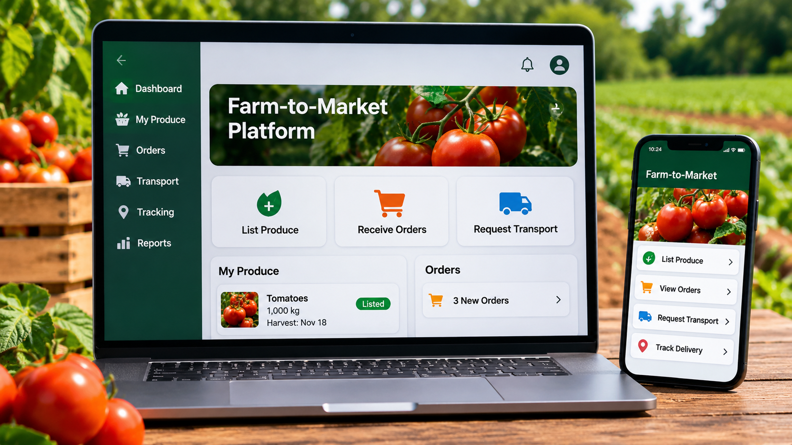
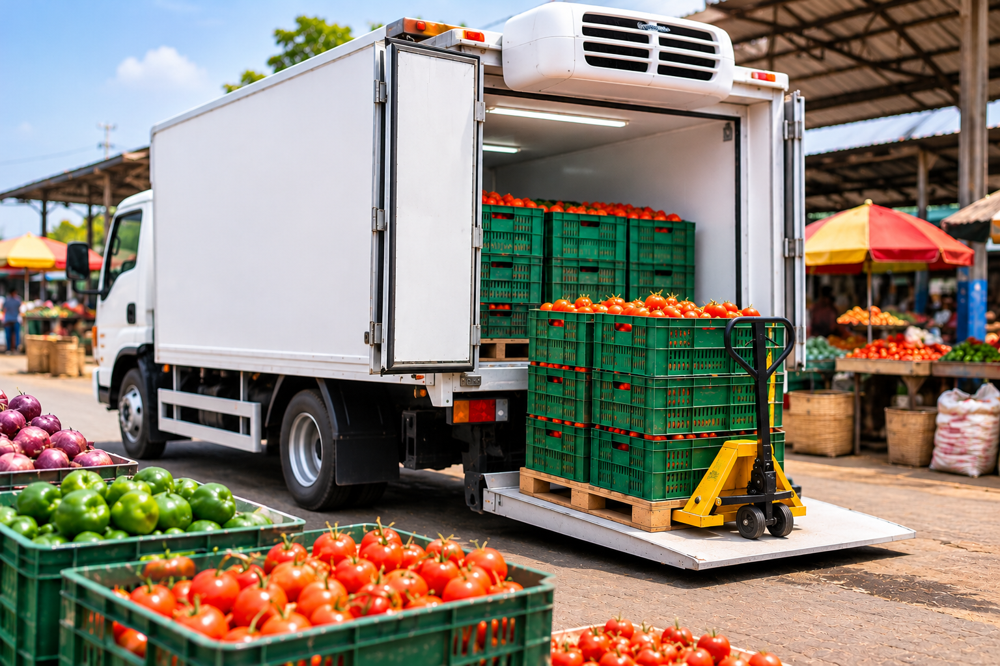

Imagine a tomato farmer in Techiman who has spent months preparing his farm for harvest. The tomatoes are ready, but there is one problem: he does not know who will buy them, how much they are willing to pay or how to get the produce to the market on time.

A few kilometers away, a market woman in Accra is looking for fresh tomatoes to sell. She needs to know where she can get them, how much is available and when they will arrive. Both have what the other needs, yet connecting them is not always easy.

This is where technology can make a difference.

Farmers need more than the ability to grow food. They also need the knowledge and tools to find markets, communicate with buyers and organize transportation. Teaching farmers how to use technology can help bridge the gap between what is produced on farms and what consumers need in the market.

**Making the market accessible before harvest**

Consider a simple system where a farmer can register on a digital platform and upload information about the produce available on the farm. This could include the type of crop, quantity, location, expected harvest date and selling price.

A market woman looking for tomatoes can access the platform, see what farmers have available and place an order. She can also know when the produce is expected to arrive, allowing her to plan her purchases and prepare for its arrival.

This is not just an idea. In Kenya, Twiga Foods has demonstrated how technology can connect smallholder farmers with vendors. Through its mobile-based marketplace, farmers supply produce while vendors place orders for the products they need. Twiga coordinates collection, sorting, storage and distribution, making it easier for both sides to do business.

The model shows that when farmers and buyers can access the same market information, agricultural trade becomes more organized and predictable.

**Getting the produce to the market**

Finding a buyer is only part of the solution. The produce must also reach its destination while it is still fresh.

This is where digital transportation services become important. Instead of spending hours looking for a truck after harvesting, farmers could use the platform to request transportation. They would provide the collection location, quantity of produce, destination and preferred collection time.

A refrigerated truck could then be assigned to collect the produce. Buyers could receive updates about the collection and estimated arrival time, allowing market women to know when their orders will reach them.

India's Kisan Rath mobile application provides an example of this approach. It connects farmers, traders and transport providers, allowing users to request vehicles and receive transportation quotations. The platform also supports the transportation of perishable goods using refrigerated vehicles.

**Keeping produce fresh throughout the journey**

Transportation alone does not guarantee that food will arrive in good condition. Perishable products need proper handling, storage and temperature control.

Nigeria's ColdHubs provides another useful example. The company combines solar-powered cold storage facilities with refrigerated transportation. Its logistics service helps move fruits, vegetables, fish and meat from farms to markets and other customers while maintaining suitable temperatures.

These examples demonstrate why farmers must also understand the importance of sorting, grading, proper packaging, using suitable crates and keeping produce cool after harvesting.

**Building a more connected agricultural system**

For Ghana, the opportunity is to bring these ideas together. Farmers should be trained to use digital platforms, understand market information, receive orders and request transportation. Market women and other buyers should also be able to participate by placing orders and tracking deliveries.

The goal is not simply to introduce farmers to smartphones or applications. It is to help them understand how technology can improve the way they produce, sell and distribute food.

At CryoChain, this is an important part of building a more connected agricultural system. By bringing together digital information, market access, cold storage and refrigerated transportation, farmers can have a better opportunity to reach buyers and protect the value of their harvests

The future of agriculture is not only about growing more food. It is also about ensuring that what farmers grow has a market, reaches that market on time and gets there in good condition.

**Because a successful harvest should not end with a farmer struggling to find someone to buy it or a truck to transport it.**

## Cited works

1. ColdHubs. (n.d.). *Our services*. <https://coldhubs.com/our-services>
2. Global Agriculture and Food Security Program. (n.d.). *Technology connects Kenyan smallholders with market access*. <https://www.gafspfund.org/index.php/projects/technology-connects-kenyan-smallholders-market-access>
3. Ministry of Agriculture & Farmers Welfare. (2020, April 17). *Agriculture Minister Shri Narendra Singh Tomar launches “Kisan Rath” mobile app to facilitate transportation of foodgrains and perishables during lockdown*. Press Information Bureau, Government of India. [https://www.pib.gov.in/newsite/PrintRelease.aspx?lang=2&reg=48&relid=202327](https://www.pib.gov.in/newsite/PrintRelease.aspx?lang=2&reg=48&relid=202327)
4. Mulinge, W., Bett, C., Makokha, S., Magenya, O., Thuranira, E., Makini, F., & Thuku, B. (2024). *Report on digital platforms in Kenya: A case study of Twiga Foods*. FARA Research Report, 8(4). <https://research4agrinnovation.org/publication/digital-platform-kenya/>
