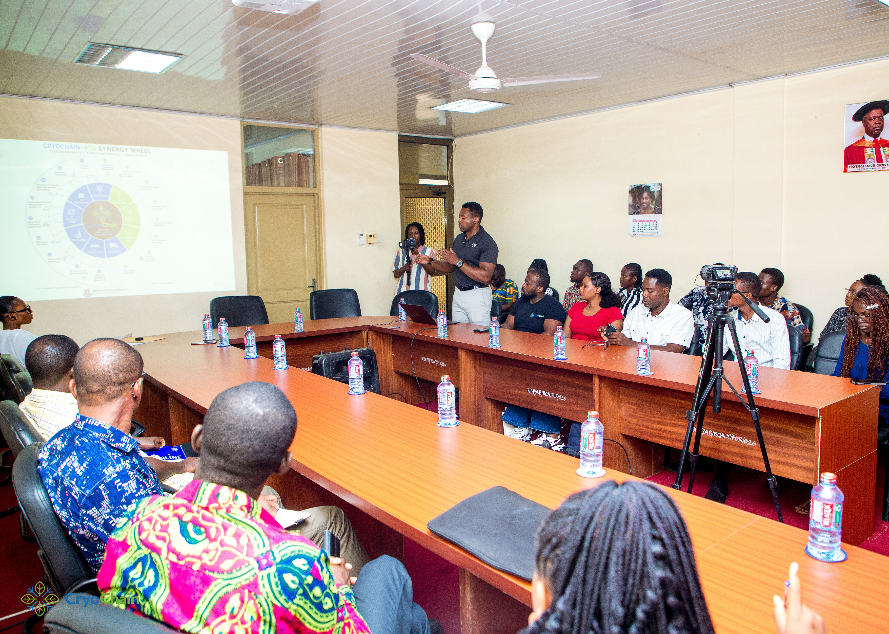

Agriculture is changing, and the future of the industry will depend on more than fertile land, good harvests and modern machinery. It will depend on the people who have the knowledge, technical skills and innovative thinking to make agricultural systems more productive, efficient and sustainable.

For Ghana, empowering young people to become active participants in this transformation is essential. Yet, agriculture is still often viewed as traditional farming, with limited career opportunities. The reality is that modern agriculture extends far beyond the farm. It encompasses technology, engineering, food processing, refrigeration, logistics, renewable energy, research and entrepreneurship.

This is the future CryoChain wants to help create.

Through strategic partnerships, infrastructure development and skills development initiatives, CryoChain is working towards creating opportunities for young people to learn, develop practical expertise and become part of a growing agricultural and cold chain industry.

### Connecting Education to Real-World Opportunities

One of the important steps towards this vision is CryoChain's partnership with Koforidua Technical University (KTU). The collaboration seeks to bridge the gap between academic learning and industry experience by creating opportunities for practical training, knowledge sharing, research and skills development.

Through this partnership, CryoChain aims to expose students to the different aspects of modern agricultural infrastructure, including cold storage, food handling, processing, refrigerated transportation and logistics.

The goal is to help young people understand how technology and innovation are applied across the agricultural value chain while equipping them with skills that can translate into meaningful career opportunities.

CryoChain also plans to establish its first operational hub in Koforidua, bringing infrastructure, employment and training opportunities closer to the community. By engaging local talent and developing technical capacity, the company wants young people to become contributors to the agricultural economy rather than observers of its transformation.

### Building Technical Expertise Through International Partnerships

Youth empowerment also requires access to specialized technical knowledge. This is where CryoChain's partnership with CLW Automotive in China becomes particularly important.

Beyond the exploration and supply of refrigerated trucks, the partnership seeks to facilitate technical knowledge transfer and training. Through this collaboration, CryoChain aims to create opportunities for young Ghanaians to develop expertise in refrigerated vehicle technology, refrigeration systems, vehicle maintenance and related technical fields.

As Ghana's cold chain industry develops, the demand for people who can operate, maintain and service these technologies will grow. Developing these skills locally can reduce dependence on external technical support while creating new employment opportunities for young professionals.

It also introduces young people to career paths that may not traditionally be associated with agriculture, demonstrating that the industry offers opportunities in engineering, transport technology and technical services.

### Making Agriculture Attractive to the Next Generation

For agriculture to attract more young people, they must see it as an industry where they can build careers, businesses and innovative solutions.

CryoChain's broader vision is built around connecting farms to reliable cold storage, processing facilities, refrigerated transportation and markets. Each part of this infrastructure creates opportunities for employment, entrepreneurship and specialized skills.

From managing cold storage facilities and operating refrigerated trucks to food processing, logistics, quality control and technology management, the opportunities extend across an entire value chain.

By introducing young people to these possibilities, CryoChain wants to encourage a shift in how agriculture is perceived. It is not simply about planting and harvesting crops. It is about building businesses, applying technology, solving problems and creating value.

### Investing in People to Transform Agriculture

Infrastructure alone cannot transform an industry. It requires skilled people who can operate it, maintain it, improve it and develop new solutions for the challenges ahead.

For CryoChain, investing in the next generation is therefore an important part of building a stronger agricultural ecosystem. Its collaborations with KTU and CLW reflect an approach that combines education, practical experience, international knowledge transfer and employment opportunities.

The ambition is to help create a generation of young agricultural professionals, technicians, entrepreneurs and innovators who can contribute to Ghana's food security, strengthen local industries and support the growth of agriculture across West Africa.

The future of agriculture should not be built without young people. They should be trained, equipped and given the opportunity to lead it.

**CryoChain is building more than cold chain infrastructure. It is helping create the skills, opportunities and human capacity needed to shape the future of agriculture.**
